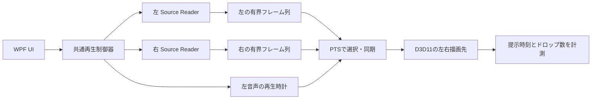

# C#・WPF版 移行検証 詳細設計書

更新日: 2026-10-28  
対応する要件: [移行検証仕様書](CSharp_WPF_移行検証_仕様書.md)  
実装先: ユーザー指定により、このフォルダー内の独立した`VideoQualityAnalyzer.Wpf.sln`

## 1. 実装方針

最初に小さな2画面プレビューアプリを作り、実測してから完成版への移行を決める。現行の画面全体を先に写経しない。段階AはWPFの`MediaElement`、段階Bは必要時に`Media Foundation Source Reader`とGPU描画を使用する。品質評価は完成版でもFFmpeg/FFprobeの外部プロセスを再利用する。

段階Aで`MediaElement`が2本を独立して再生するため、共通の操作時刻を与えてもフレーム精度の同期は保証できない。再生中に40 ms刻みで`Position`を更新する実装は禁止する。各プレイヤーを自然再生させ、開始・シーク時のみ位置を設定する。監視用タイマーは動画以外の表示更新と必要な再同期だけに使い、動画の提示周期を決めない。60.00 fpsの各フレームを実際に提示できたか別途計測する。

段階Bの候補はD3D11でデコード・描画し、各プレビューの子ウィンドウを`HwndHost`でWPFに配置する方式とする。動画上へのWPF部品の重ね合わせは`HwndHost`の表示領域制約があるため、動画名・状態・操作部品は領域の外側に置く。`D3DImage`はDirect3D 9サーフェスへの橋渡しが必要で、コピーや同期費用が増えるため初期選択にしない。段階Bに入る前に最小映像1本でGPU上の受け渡しが可能かを確認する。

## 2. 新プロジェクトの構成

```text
VideoQualityAnalyzer.Wpf.sln
  src/
    VideoQualityAnalyzer.App/          # WPF画面、MediaElement制御、起動
    VideoQualityAnalyzer.Core/         # 動画選択、共通時刻、測定値、契約
    VideoQualityAnalyzer.Media/        # FFprobeによる動画情報・PTS取得
    VideoQualityAnalyzer.Diagnostics/  # 匿名化した性能記録、報告用CSV
  docs/
    benchmark-results.md
  tests/
    VideoQualityAnalyzer.Smoke/        # 実素材、選択規則、診断ログの確認
```

段階Bへ進む場合のみ`VideoQualityAnalyzer.MediaFoundation`と、必要なネイティブ連携部分を加える。依存方向は`App → Core`、`App → Media`、`Media → Core`とし、`Core`はWPFへ依存しない。段階AではWPFコントロールの所有を`App`に置き、`Media`はFFprobe処理を担当する。段階Bへ進む前にプレビュースロットの契約を実装へ導入する。単にファイル数を増やすための細分化はしない。C#は`PascalCase`の型・公開メンバー、`camelCase`の局所変数を使う。コメントと画面文言は日本語にし、非同期処理とネイティブ資源の所有・破棄理由を説明する。

### 2.1 主要なデータ型

| 型 | 主なフィールド・責務 |
| --- | --- |
| `VideoDescriptor` | `Id`, `Path`, `Width`, `Height`, `AverageFrameRate`, `NominalFrameRate`, `Duration`, `Codec`, `HasAudio`, `IsVariableFrameRate`, `FrameTimes`。パスを画面に表示しても性能ログへは書かない。 |
| `PreviewSelection` | `LeftVideoId?`, `RightVideoId?`, `Generation`。変更のたびに世代番号を増やす。 |
| `PlaybackState` | `Stopped`, `Preparing`, `Playing`, `Paused`, `Seeking`, `Failed`。左右の個別状態は別に持つ。 |
| `PreviewFrameInfo` | `VideoId`, `Generation`, `SourcePts`, `FrameIndex?`, `PresentedAt`, `DecodeMode`。段階Bの計測と同期に使用。 |
| `MeasurementEvent` | 匿名ID、イベント種別、単調時刻、左右、動画条件、結果。壁時計ではなく`Stopwatch.GetTimestamp()`で差を取る。 |

### 2.2 主要な契約

```csharp
public interface IPreviewSlot : IAsyncDisposable
{
    Task OpenAsync(VideoDescriptor video, long generation, CancellationToken cancellationToken);
    Task SeekAsync(TimeSpan position, long generation, CancellationToken cancellationToken);
    void Play();
    void Pause();
    Task CloseAsync();
    event EventHandler<PreviewReadyEventArgs>? FirstFrameReady;
    event EventHandler<PreviewErrorEventArgs>? ErrorOccurred;
}

public interface IVideoProbe
{
    Task<VideoDescriptor> ProbeAsync(string path, CancellationToken cancellationToken);
}
```

`IPreviewSlot`はUIへの更新通知を含むため、実装はWPFディスパッチャーへ戻す位置を明示する。`OpenAsync`の完了は「ファイルを開く操作の完了」であり、初回フレームの表示完了とは別に扱う。段階Aで`MediaElement`の提示フレーム通知が取れなければ、`FirstFrameReady`は`MediaOpened`や位置変更イベントで代用せず、画面上は「準備完了」と「初回表示の計測可否」を分ける。段階Bでは実際の描画完了時に発火する。

## 3. 段階A: WPF標準再生の設計

### 3.1 画面

上段に動画一覧と元動画指定、中央に左右の同寸プレビュー、下段に再生操作・共通シークバー・測定情報を置く。`MediaElement`は2個を固定して使い回し、`LoadedBehavior=Manual`、`UnloadedBehavior=Manual`、`ScrubbingEnabled=true`とする。右側は常時消音する。左側を音声基準にできる場合は左の`Position`を監視し、音声がない場合は`Stopwatch`を基準時刻にする。動画領域はプレイヤーが独立して描画し、時刻・シークバー・性能表示の定期更新は目安4～10回/秒にまとめる。監視周期は動画の提示やフレームごとのシーク指令には使わない。重い情報取得・集計・ログ書き込みはUIスレッド上で同期実行しない。

### 3.2 選択変更

1. 一覧選択を`SelectionService`が最大2本の`PreviewSelection`へ変換する。片側のIDが同じなら、そのプレイヤーの`Source`を変更しない。
2. 変わる側だけ新しい`CancellationTokenSource`と世代番号を発行し、旧世代の結果を無視する。UIには「読み込み中」を表示する。古い画は動画名と取り違えないよう明示する。
3. 新しい`Source`を設定して`MediaOpened`を待ち、共通時刻へ`Position`を設定する。イベントの発火順に依存しないよう、世代番号と対象パスを照合する。
4. 切り替え中の再生状態が`Playing`なら再生を始める。初回描画の厳密な通知は標準APIにないため、切り替え時間は外部計測手段と合わせて測る。
5. 古いプレイヤーは`Close()`してファイルハンドルを解放する。前後の動画を同時に開く方式を採用する場合は、ピークメモリとファイルロック時間を測ってから上限を決める。初版は先読み対象を増やさない。

`MediaFailed`、`MediaEnded`、音声なしを個別に扱う。未対応形式があっても、Windows標準の再生環境で開けるかどうかを測定結果として残し、FFprobeが読めることを再生可能の判定に使わない。

### 3.3 再生とシーク

- 再生開始時に左右を同一の共通時刻へそろえ、右側を先に、左側を直後に`Play()`する。起動時刻の差は計測する。
- 一時停止時は両方を止めて共通時刻を確定する。停止は先頭へ戻す。2本の短い方の終端で止める。
- シークバー操作中は連続イベントを約50 ms単位でまとめ、操作確定時に最後の位置を必ず送る。古いシーク完了後に新しい位置を上書きしない。
- フレーム移動は左動画のPTS一覧を使用する。段階Aで実際の表示位置がずれる場合は、その動画でP-05未達と記録する。
- 監視タイマーで左右の`Position`差が100 ms以上、一定時間続いた場合のみ右を再同期する。再同期の回数と画面の跳びを記録し、数値を隠さない。`Position`差は実際の提示PTS差ではないため、同期の合格判定には用いない。

## 4. 段階B: 専用プレビューの設計

段階Aが要件に届かない場合に実施する。まず「1本のファイルをSource Readerでハードウェアデコードし、D3D11の子ウィンドウへ描画する」最小実験を行う。GPUからCPUへ毎フレーム読み戻して`WriteableBitmap`へコピーする実装を本線としない。ハードウェアデコードが使えない動画はソフトウェアデコードへフォールバックするが、そのときのfpsを別枠で報告する。

### 4.1 パイプライン



- 左右に独立した読み取り作業を置く。各ReaderとCOM資源の操作スレッド・所有者を固定し、UIスレッドで同期的に`ReadSample`しない。
- `MF_SOURCE_READER_D3D_MANAGER`へDXGIデバイスマネージャーを渡し、利用できればGPU上のデコードサーフェスを保持する。実際のHW/SW選択と転送方式を記録する。
- フレーム列は各側3～6枚程度から開始し、上限をバイト数と枚数の両方で制限する。再生中は古いフレームを捨てて音声時計に追いつく。最新のシーク・選択要求を優先する。
- 1つの再生時計を持つ。音声が再生できる場合は左音声の実再生時刻を基準にし、なければ高精度単調時計を使う。`Source Reader`自体には提示時計も音声同期もないため、アプリ側がPTSに基づき「次に提示すべき左右のフレーム」を選ぶ。
- 左音声は別の音声パイプラインでデコードし、Windowsの音声出力へ渡す。音声時計の取得が安定しない場合は単調時計を基準にし、音声を必要なときだけ補正する。右音声は読まない。音声実装の成立は映像だけの試作後の別ゲートとする。
- D3D11の各スワップチェーンを`HwndHost`内の子HWNDへ出す。色変換・拡大縮小・ズーム・パンはGPU側で行う。動画の上にWPF操作部品を載せない。デバイス喪失・ウィンドウ移動・DPI変更・サイズ変更時は描画先を再作成し、再生時刻を保持する。
- 動画提示はソースPTSと表示装置の更新時刻を基準にスケジュールする。60.00 fps素材を60 Hz以上の画面で再生するときは、左右それぞれ次の異なるソースフレームを次の提示機会へ渡せるよう、デコード・色変換・描画を並行させる。描画完了待ちやUI更新を再生時計の進行条件にしない。表示装置の実更新率とソースレートが異なる場合は、その差に伴う重複・欠落を別に記録する。
- WPFの時刻・シークバー・動画情報・性能表示は目安4～10回/秒でまとめて更新する。操作時の状態変化は直ちに通知するが、動画フレームごとにWPFのプロパティ群を更新しない。集計とログ保存は有界キューを介して別作業で行い、描画経路を塞がない。

### 4.2 フレーム選択

1. デコードしたサンプルのPTSを保持する。平均fpsだけでフレームIDを決めない。Bフレームを含む動画では表示時刻順に並ぶことを確認する。
2. 共通時計が示す時刻以下の最新フレームを左右それぞれ選ぶ。先行しすぎるフレームは待ち、遅れたフレームは落としてドロップ数を数える。
3. 片側だけ遅いとき、速い側は最後の正しい画を保持する。両方が永久に待ち合う構造にしない。左右PTS差が閾値を超えた回数を記録する。
4. シーク時は現在の要求を無効化し、両側を指定位置付近のキーフレームへ移動して、目的PTSに届くまで読み進める。表示完了までは直前の画を残し、完了した側から状態を更新する。
5. VFRではサンプルPTSをそのまま使用する。フレーム時刻の無い素材はFFprobeの時刻表、さらに取得できない場合だけ平均fps近似に落とす。

## 5. ファイル切り替えと資源管理

`PreviewCoordinator`が左右の`VideoId`と世代番号を管理する。表示対象の変更で変わらない側のReader/MediaElementは再オープンしない。新しい対象のオープン、シーク、初回描画を段階別に計測する。キャンセル時は「完了した古い作業を描画しない」ことを最優先し、ネイティブ処理が即時中断できない場合も結果を破棄して資源を確実に解放する。

事前読み込みを追加するのは、計測でオープン時間が主因と分かった場合のみ。候補は次に選びやすい比較動画1本に限定し、メモリ上限・ファイルハンドル上限・アイドル時間を設定する。一覧から外した動画、セッション終了、アプリ終了では即時解放する。現行の「表示対象以外は解放する」性質を変える場合は、速度とファイルロックのトレードオフを報告書に載せる。

## 6. 情報取得、測定、ログ

FFprobeは`ProcessStartInfo.ArgumentList`へ引数を個別に追加し、非表示で起動する。標準出力と標準エラーを非同期に読み、キャンセル時はプロセスを終了する。最初の映像ストリームを選び、平均fps、公称fps、長さ、コーデック、音声有無を取得する。VFRのフレームPTS取得は必要になった動画に限り、画面を止めずに行う。動画長さが長い場合に全フレーム時刻を無制限に保持しない設計を追加検討する。

性能イベントはJSON LinesまたはCSVへ保存する。最低限の列は`run_id, phase, video_id, side, source_fps, resolution, codec, decode_mode, timestamp_monotonic, elapsed_ms, source_pts_ms, presented_frame_id, dropped_frames, cpu_percent, gpu_percent, memory_mb`。提示フレームIDと提示時刻は左右別に記録し、デコード完了やキュー投入とは区別する。計測器自身による負荷を比較するため、詳細記録のON/OFF両方を一度測る。画面のfps表示は直近数秒の窓で計算し、開始準備期間を含めない。動画以外のUIは目安4～10回/秒で値を更新してよく、その更新回数を動画fpsとして表示しない。60.00 fpsの合否は30秒区間の期待1800フレームに対する提示数・欠落数と、提示間隔で判定する。結果表には同じ動画と設定での現行版・段階A・段階Bを横並びにする。

## 7. 完成版への拡張順

1. プレビュー検証の結果を確定し、採用する再生エンジンを1つ選ぶ。段階Aで足りるなら段階Bの複雑な連携を持ち込まない。
2. 現行の`VideoInfo`、`VideoItem`、`MetricResult`に対応するデータ構造と選択規則を移す。旧仕様書の例外動作を確認する。
3. FFmpeg/FFprobeの検出、品質評価ジョブ、キャンセル、途中結果、完了済み結果の扱いを移す。指標ごとの同一入力で現行版とCSVの値を比較する。
4. グラフ・グループ線・シーク連携、CSV、設定、ログ、配布を順次追加する。描画やグラフ更新を動画フレームの経路へ戻さない。

## 8. AI実装担当へ渡す指示文

以下を新プロジェクトの最初の依頼にそのまま添付できる。実装の各段階で測定結果を見てから次へ進める。

> 添付の「C#・WPF版 移行検証仕様書」と「詳細設計書」に従い、まず段階Aの独立した.NET 10 / WPFアプリを実装してください。現行Python版は変更しないでください。最初の成果物は2画面プレビュー、左音声、再生・一時停止・停止・シーク、動画切り替え、FFprobeによる動画情報、性能測定ログ、測定手順書です。左右の動画領域はそれぞれ60.00 fps素材の全フレーム提示を目標とし、時刻や性能表示など動画以外のUIは目安4～10回/秒の更新で構いません。日本語UIと日本語コメントを使ってください。40 msごとに動画をシークする設計は採用しないでください。標準の`MediaElement`で実際の提示フレームを正確に数えられない項目は、測定できたかのように表示せず、外部計測または「未測定」と報告してください。段階Aの結果と未達項目を提出し、段階Bの着手判断に必要な根拠を示してください。

## 9. 実装時に参照する一次資料

- [WPF MediaElementの制御](https://learn.microsoft.com/en-us/dotnet/desktop/wpf/graphics-multimedia/how-to-control-a-mediaelement-play-pause-stop-volume-and-speed)
- [Media Foundation Source Readerの範囲と制約](https://learn.microsoft.com/en-us/windows/win32/medfound/source-reader)
- [Source ReaderとDXGIデバイスマネージャー](https://learn.microsoft.com/en-us/windows/win32/medfound/mf-source-reader-d3d-manager)
- [Source ReaderのシークとPTS](https://learn.microsoft.com/en-us/windows/win32/medfound/processing-media-data-with-the-source-reader)
- [WPFとWin32のHwndHost連携](https://learn.microsoft.com/en-us/dotnet/desktop/wpf/advanced/wpf-and-win32-interoperation)
- [WPFのD3DImage性能上の注意](https://learn.microsoft.com/en-us/dotnet/desktop/wpf/advanced/performance-considerations-for-direct3d9-and-wpf-interoperability)
