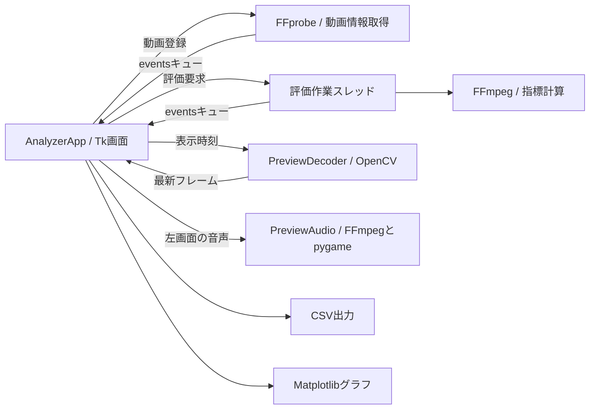

# Video Quality Analyzer Tool 詳細設計書

> 旧Python版の参考資料です。本文の「現行」は旧Python版を指します。C#・WPF版の方針は[完成版仕様書](../CSharp_WPF_仕様書.md)を参照してください。

更新日: 2026-10-27  
対象: 現行実装（`pyproject.toml` のバージョン 0.1.0）  
利用者向けの振る舞い: [仕様書](仕様書.md)

## 1. 全体構成

`python -m video_quality_analyzer` またはエントリーポイント `video-quality-analyzer` から `app.main()` を呼ぶ。`AnalyzerApp` が Tk のメインスレッドで状態と画面を管理し、動画情報取得・品質評価・プレビューの読み取り・音声変換は作業スレッドへ分ける。Tk 部品は原則メインスレッド側で更新する。

## 2. モジュールと責務

| ファイル | 主な責務 |
| --- | --- |
| `app.py` | 起動、メイン画面とメニューの構築、共有状態、設定保存、CSV ダイアログ、終了 |
| `video_list_ui.py` | 動画追加、元動画、選択、グループ、並べ替え、削除済み動画への対応 |
| `evaluation_ui.py` | 評価ジョブ、キャンセル、通知キューの処理、途中結果と完了結果の反映 |
| `ffmpeg.py` | 実行ファイルの検出、FFprobe による情報取得、FFmpeg 指標計算とログ解析 |
| `preview_decoder.py` | OpenCV の `VideoCapture` を用いた最大 2 本のフレーム取得 |
| `preview.py` | プレビューの Tk 部品、拡大表示、デコード要求・結果の表示 |
| `playback_ui.py` | 再生時刻、シーク、コマ送り、音声との同期 |
| `audio.py` | 音声の一時 OGG 変換、pygame 再生、音量とミュート |
| `graph_ui.py` | 時系列・平均品質グラフ、色、間引き、クリック操作 |
| `settings_ui.py` | 設定ダイアログ、フォント、FFmpeg 状態表示 |
| `models.py` | `VideoItem` と指標名の定義 |
| `exports.py` | 動画単位・フレーム単位 CSV の書き込み |
| `logging_setup.py` / `process_utils.py` | ログと外部プロセス起動の共通処理 |
| `plot_fonts.py` | グラフの日本語フォント設定 |

`AnalyzerApp` は各 `*UIMixin` を継承する。各 Mixin は独立したアプリではなく、`AnalyzerApp` の共有属性（`items`、`reference`、`events`、各 Tk 部品など）を使う。

## 3. 主なデータ構造

| 型・属性 | 内容 |
| --- | --- |
| `VideoInfo` | 動画パス、幅・高さ、fps、長さ、ビットレート、ファイルサイズ、コーデック、プロファイル、可変 fps 情報、フレーム時刻 |
| `VideoItem` | `VideoInfo`、指標別 `MetricResult`、完了済み指標集合、元動画フラグ、グループ名 |
| `MetricResult` | 比較動画パス、指標名、平均値、`(フレーム番号, 評価値)` の列 |
| `AnalyzerApp.items` | 登録動画の順序付きリスト。並べ替え時はこの順序を更新する |
| `AnalyzerApp.reference` | 元動画の `VideoInfo`。未選択時は `None` |
| `AnalyzerApp.events` | 作業スレッドから画面へ渡す通知キュー |
| `DecodeRequest` / `DecodeResult` | プレビュー対象、時刻、要求番号、世代番号と、読み取ったフレーム・エラー |

`VideoInfo.frame_time(frame)` はフレーム時刻がある場合はそれを返し、ない場合は `frame / fps` で近似する。可変 fps 判定は FFprobe の平均フレームレートと公称フレームレートの差が 0.01 を超えるかで行う。

## 4. 動画追加と一覧の更新

1. `add_videos()` またはドロップ処理でパスを受け、登録済み・処理待ちの同一パスを除く。
2. `_add_video_paths()` が `video-prober` スレッドを起動する。`_probe_video_paths()` は各動画を `ffmpeg.probe()` に渡す。
3. `probe()` は `ffprobe` の JSON 出力から最初の映像ストリームを読む。ストリーム側の値がない場合はコンテナー側の長さ・ビットレート等を使い、ビットレートがないときはファイルサイズと長さから推定する。可変 fps と判定したときだけ、別の FFprobe 呼び出しで各フレームの時刻を取得する。
4. 作業スレッドは結果を `events` に入れる。`_poll()` が `videos_probed` を受け、世代番号が現在の一覧に一致する場合だけ登録する。新規セッションや一覧クリアの後に古い読み込み結果が混入しないよう、`_probe_generation` を増やす。
5. 先頭の登録動画を元動画にし、一覧・プレビュー・グラフを更新する。取得失敗時は動画ごとに警告する。

元動画を変更するときの `_set_reference_item()` と、元動画削除時の `_remove_item_ids()` は、残りの比較動画も含めて `metrics` と `completed_metrics` を消去する。評価値を異なる元動画に流用しないため。

## 5. 品質評価と中断

1. `evaluate_selected()` は元動画、比較動画、チェックされた指標を検証し、`completed_metrics` にない組み合わせを作る。動画情報取得中と評価中は開始しない。
2. `quality-evaluator` スレッドの `_evaluate_worker()` は、指標と動画の組み合わせを順に `compare()` へ渡す。画面を直接触らず、`status`、`metric`、`frame`、`progress`、`done`、`finished` を `events` へ送る。
3. `compare()` は一時フォルダーに指標ログを作り、指標ごとに FFmpeg を実行する。比較動画と元動画に `setpts=PTS-STARTPTS` を適用し、VMAF は `libvmaf`、SSIM は `ssim`、PSNR は `psnr` フィルターを使う。VMAF は JSON の pooled mean を優先し、SSIM/PSNR は有効なフレーム値の平均を計算する。PSNR が無限大のフレームは統計系列から除外する。
4. `_poll()` は約 100 ms ごとに通知を取り出す。フレーム通知で途中結果を更新し、`done` で完了結果を確定する。途中のグラフ再描画は約 0.35 秒間隔に抑える。
5. 中断は `threading.Event` で通知する。FFmpeg の進捗が止まっても中断を監視し、対象プロセスを終了する。中断中の組み合わせの途中結果は削除し、完了済みの別結果は保持する。

FFmpeg の標準エラーを無制限に保持しない。通常の診断ログにも動画のフルパスや外部コマンドの引数を記録しない。

## 6. プレビューと音声

- `VideoListUIMixin.preview_items()` が最大 2 本を選ぶ。選択なしなら元動画と先頭または直前の右側動画、1 本選択なら原則元動画と選択動画、2 本以上なら先頭 2 本を使う。
- `PreviewPanel.render()` が時刻と対象を受け、`PreviewDecoder` に要求を送る。要求と結果のキューは各 1 件で、古い要求は最新の位置で置き換える。要求番号と世代番号で、対象変更やシーク後に古い結果を描画しない。再生中は遅れたフレームを表示して描画の途切れを抑える。片側の動画だけを同じ時刻で切り替える場合は、変わらない側の画像を読み取り完了まで残す。拡大時は画像全体を Canvas に配置し、ドラッグ操作では画像を再生成せず左右のスクロール位置を同期する。
- `PreviewDecoder` は左右にそれぞれ作業スレッドを持ち、同じ要求番号の結果が両方そろってから画面へ返す。各スレッドは OpenCV の `VideoCapture` を保持し、短い連続前進では読み進め、大きな移動では時刻でシークする。現在位置から未来10フレーム、過去5フレームまでを保持し、近い位置への移動では再デコードを省く。離れた位置へシークした後は、別の一時的な capture で過去側を準備し、新しい操作が入れば中断して解放する。現在の画像を含むキャッシュは1本あたり最大512 MiBとし、容量不足時は遠い未来の画像から外す。可変フレームレート動画では前後のフレームキャッシュを使わない。表示対象から外れた動画の capture と画像は解放し、終了時にも全 capture を解放する。
- ハードウェアデコードが有効な場合、`VideoCapture` を開くときに FFmpeg バックエンドへ `VIDEO_ACCELERATION_ANY` を指定する。OpenCV が利用可能な方式を選べない場合や、ハードウェアでフレームを読めない場合は通常の `VideoCapture` へ戻す。設定変更時は表示中の capture を開き直す。実際に選ばれた方式は診断ログに記録する。
- 一覧で表示対象を切り替えるときは、先にプレビュー要求を送り、その後にグラフを描き直す。デコードをグラフ描画と重ね、最初の画像までの待ち時間を減らす。
- `PlaybackUIMixin._tick()` は約 40 ms ごとに時刻を進める。音声が準備できていれば音声位置を映像時刻の基準にし、なければ画面時刻を進める。再生対象の短い方の終端で停止する。
- `PreviewAudio` は左側動画の最初の音声ストリームを FFmpeg で OGG に変換し、一時フォルダーに保存する。表示対象が変わったときは不要な抽出プロセスを終了する。再生位置の小さな差は許容し、大きくずれたときに再同期する。終了時はプロセス、pygame、テンポラリファイルを後片付けする。

プレビュー中に開いている動画ファイルは一時的にロックされる場合がある。これは過去のチャットで求められた応答性を優先し、対象動画だけの capture を再利用する設計による。

## 7. グラフ

- `GraphUIMixin.redraw()` は指標別の時系列軸と平均品質対ビットレート軸を描く。時系列軸は選択対象、平均値軸は評価結果を持つ全比較動画を使う。
- 長い系列は `_plot_samples()` が先頭・末尾と区間ごとの最小・最大を残し、表示点数をおおむね 6,000 点以下にする。CSV 用の元データは保持する。
- `_plot_color_maps()` は動画ごとの色を割り当てる。空欄グループは各動画で色相を変え、名前付きグループは色相を揃えて明るさを変える。同じ動画の色を左右のグラフで共有する。
- グループ線は `self.items` の現在の順序で点を結ぶ。ビットレート昇順に自動整列するわけではない。過去の「グラフの線の接続順を調査」チャットでも、この表示順が確認されている。
- 時系列軸でのクリック・ドラッグは `seek_to()` へ、平均値軸の点クリックは動画一覧の選択へ接続する。再生位置の縦線更新は全系列の再描画を避ける。

## 8. 設定、CSV、ログ、配布

### 8.1 設定

`_settings_path()` は開発版ではプロジェクトルート、ポータブル版では実行ファイルの隣に `settings.json` を置く。保存項目は `metrics`、`load_previous_settings`、`screen_font_family`、`graph_font_family`、`graph_font_size`、`ffmpeg_folder`、`preview_hardware_decode`。書き込み時は一時ファイルを作って置き換える。読めない・破損した JSON は空の設定として扱う。評価指標は「前回の設定を読み込む」が有効なときだけ復元する。ハードウェアデコードは初期状態で無効とし、保存した値を次回起動時に読み込む。

### 8.2 FFmpeg の検出

明示設定があればそのフォルダー直下の `bin/ffmpeg.exe` と `bin/ffprobe.exe` を使用する。明示設定先に実行ファイルがない場合は自動検出へ切り替えない。未設定なら、ポータブル版のアプリ隣接候補、開発版の `tools/ffmpeg/` 候補、システム `PATH` の順で各実行ファイルを探す。起動時と設定画面で `ffmpeg -filters` を使い `libvmaf` の有無を確認する。VMAF の実行前にも対応を確認する。

### 8.3 CSV

`exports.write_summary()` は `file,width,height,fps,duration_seconds,bitrate_kbps,size_bytes,VMAF_mean,SSIM_mean,PSNR_mean` の列を出力する。`write_frames()` は `file,metric,frame,time_seconds,score` の列を出力する。両方とも `utf-8-sig` で作成する。フレーム時刻は `VideoInfo.frame_time()` で求める。動画単位 CSV には登録中の `items` を渡し、フレーム単位 CSV には結果がある動画だけを渡す。

### 8.4 ログと配布

`logging_setup.py` は `%LOCALAPPDATA%/VideoQualityAnalyzerTool/logs/application.log` にローテーションログを作る。1 ファイルは最大 2 MiB、バックアップは 4 個。ログの保存に失敗しても起動は続ける。Windows の外部コマンドは `process_utils.hidden_process_options()` でコンソールを表示せずに起動する。`build-portable.ps1` は依存ライブラリを含む PyInstaller のフォルダーを作り、ZIP 化する。FFmpeg と FFprobe は利用者が別途配置する。

## 9. 更新時の確認事項

- 仕様を変えた場合は、本書と [仕様書](仕様書.md) の該当箇所を同時に更新する。
- `AGENTS.md` に従い、コード変更後は構文チェックを行う。テストの追加・実行は明示依頼がある場合に行う。
- 特に元動画変更時の評価結果無効化、評価中の一覧操作、シーク後の古いフレーム、動画のファイル解放、可変 fps の時刻、グループ線の接続順は、過去のチャットで不具合または設計判断があったため、変更時に確認する。
